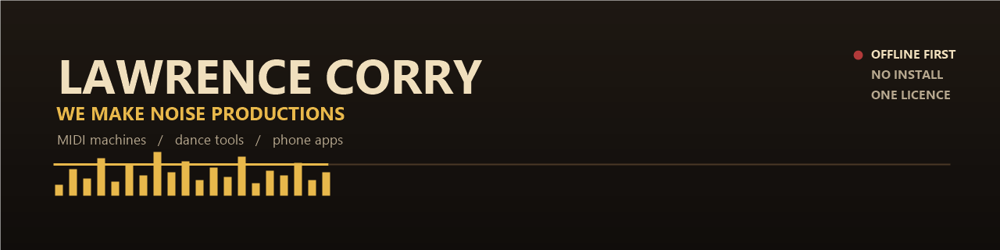

# Lawrence Corry

**Musician, songwriter and toolmaker.**  
I run **We Make Noise Productions** and build the music software I could not buy: MIDI machines, belly dance practice studios, sound FX desks and small phone apps that work offline.

Former guitarist. These days I write, produce and build with dictation and AI assistance. The tools are how I keep making music.

---

## What I build

| | |
|---|---|
| **Music** | Rock, blues, belly dance, jazz, prog and club. Songs, arrangements and MIDI. |
| **PC tools** | Offline PowerShell and WinForms apps. No install, no cloud, no account. |
| **Phone apps** | Browser based, one file, works on Android and iPhone, Bluetooth friendly. |
| **Sound** | CC0 libraries, synthesised effects, Foley-style desks and game-table sound boards. |

## Selected work

### SERPENTINE - Belly Dance Studio
The complete belly dance studio for the phone. 29 rhythms, 32 lessons, choreography, dance guide, zills with chords, drum and zill combo, MIDI export.  
`browser app` `Android / iPhone` `MIDI`

### NOISE ENGINE - MIDI machine
A phone song machine. Pick a style, key and scale, and it writes drums, bass, chords and melody, then exports a multi-track MIDI file.  
`browser app` `MIDI` `multi-track`

### WMNP MIDI Kits
Desktop song kits for rock, blues, metal, jazz and prog. Fourteen parts, song templates, scales, chord tables and a lot of tested edge cases.  
`PowerShell` `WinForms` `MIDI`

### BACKLOT
Sound FX and screen-sound desks: cartoon noises, film and TV sound, tabletop game boards, and a CC0 library that can be sold with the tools.  
`offline` `CC0` `sound design`

## How I work

- **Offline first.** No login, no subscription, no data collection.
- **One file where possible.** If it needs a manual, it is not finished.
- **Test on the device.** A phone app is tested on a phone, not just the build machine.
- **Own or CC0 material only.** No borrowed sample packs.
- **Plain language.** The person using it should not need to know what a DAW is.

## Toolbox

`PowerShell` `WinForms` `JavaScript` `Web Audio` `MIDI` `REAPER` `CC0 audio` `offline UX` `testing`

## Currently

Building the **WMNP Phone Pack**: SERPENTINE and NOISE ENGINE, one $55 licence, browser based, Android and iPhone, Bluetooth friendly.

## Find me

- GitHub: [@lojaccorry-a11y](https://github.com/lojaccorry-a11y)
- We Make Noise Productions

(c) 2026 Lawrence Corry / We Make Noise Productions. All rights reserved.
